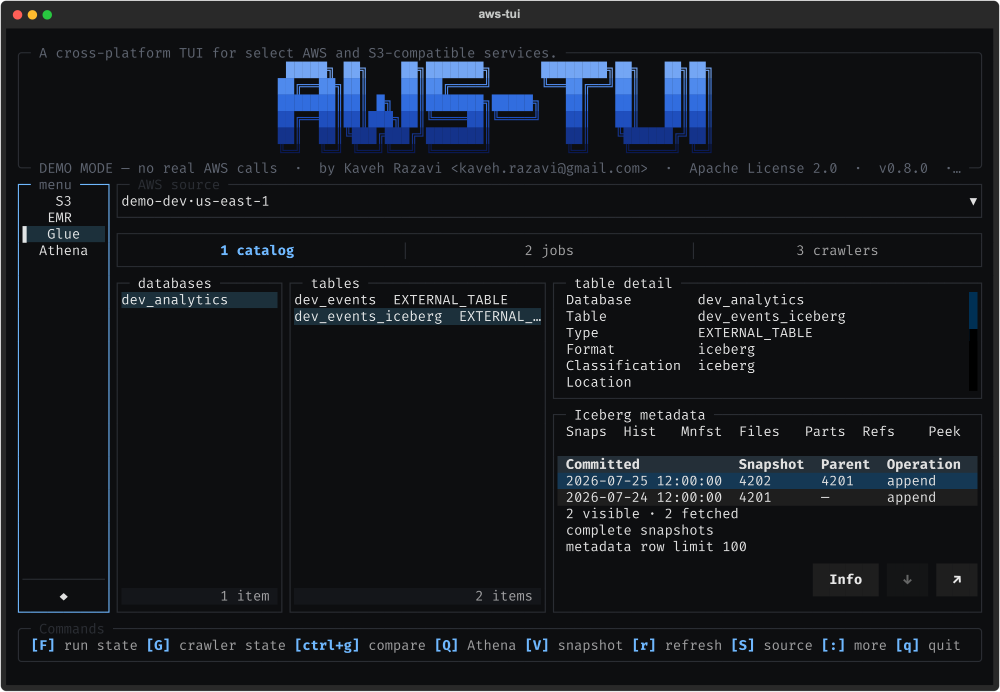

# aws-tui

aws-tui is a terminal interface for AWS and S3-compatible storage. It provides
S3 file management and consoles for EMR Serverless, AWS Glue and Amazon Athena.

Use it to browse resources, transfer files, inspect logs and query tables.
AWS connections use your existing profiles. Each service keeps its selected
connection and region separate from other sources.



## 1. Capabilities

- **S3 and local files:** browse two independent panes, copy files, delete
  entries and preview file contents. Connect to AWS S3 or S3-compatible storage.
- **EMR Serverless:** browse applications and job runs, inspect S3 or CloudWatch
  logs, clone an existing Spark run and cancel an active run.
- **Glue and Iceberg:** inspect databases, tables, jobs, crawlers and Iceberg
  metadata. Open a selected table or snapshot in Athena with a starter query.
- **Athena:** choose query context, review and execute allowed read-only SQL,
  browse results and history, and open available result artifacts in S3.
- **Keyboard controls:** navigate with keys, find service actions in the
  command palette, and customize keybindings and themes.
- **Saved navigation:** reopen named workspaces and individual bookmarks across
  application runs.

Glue inspection is read-only. Glue-to-Athena handoffs prefill a
`SELECT * … LIMIT 5` query without executing it. Athena execution can incur
AWS charges and write query results, subject to your AWS permissions and workgroup settings.

S3 copy and delete operations modify files or objects. EMR clone and cancel
operations modify job state. Destructive operations require confirmation.
See the [service guides](#6-documentation) for each operation's conditions.

## 2. Requirements

- Python 3.11, 3.12 or 3.13.
- Git available on `PATH` for installation from the repository.
- macOS, Linux or Windows with a supported terminal.
- `uv` 0.13.4 or newer for the checkout workflow. Standalone installation uses `uv` or
  optional `pipx`.
- Existing AWS profiles and service permissions for AWS access, or a configured
  S3-compatible endpoint. The demo needs no AWS credentials.

See [platform guidance](docs/platforms.md) for terminal and font recommendations.

## 3. Installation

Development build: no aws-tui package is published on PyPI.
Run the current checkout with `uv`:

```bash
git clone https://github.com/thekaveh/aws-tui.git
cd aws-tui
uv sync --locked
uv run aws-tui --version
```

`uv run` uses the checkout's project environment and current code. Keep using
this workflow when you want to run your local changes.

For a separate `aws-tui` command, the [installation guide](docs/install.md#3-standalone-application-install)
explains `uv tool install` and the optional `pipx` alternative. A standalone
installation uses a separate environment and does not follow your working tree.

The optional DuckDB extra enables Glue Iceberg **Peek**, which reads rows directly
from S3 without Athena. See [optional extras](docs/install.md#2-optional-extras).

## 4. Quickstart

These commands run from the checkout root. For a standalone installation,
replace `uv run aws-tui` with `aws-tui`.

### 4.1. Explore the demo

The demo uses synthetic AWS data and sends no AWS requests. Its local pane
uses your real filesystem; local copy and delete operations affect real files.

```bash
uv run aws-tui --demo
```

The interface opens with sample resources for S3, EMR, Glue and Athena.
A **DEMO MODE** indicator identifies the session.

### 4.2. Open your AWS profile

Configure and authenticate your profile outside aws-tui first. Replace
`analytics` with the name of an existing AWS profile:

```bash
uv run aws-tui --profile analytics
```

The S3 view opens using that profile. Use the service rail or command palette
to open another service. Glue, Athena and EMR require an AWS connection;
S3-compatible connections support the file manager only.

### 4.3. Basic controls

| Key | Action |
| --- | --- |
| `Tab` / `Shift+Tab` | Move focus |
| `:` / `Ctrl+K` | Open the command palette |
| `Shift+S` | Switch the focused pane's source or active service's AWS connection |
| `Space` | Preview a file in the file manager |
| `?` | Open help |
| `q` | Quit |

The bottom Commands pane shows actions available in the current context.
See [keybindings](docs/keybindings.md) for complete controls and custom mappings.

## 5. Configuration and current limits

[Connections](docs/connections.md) explains AWS discovery, S3-compatible setup
and credential recovery. [Configuration](docs/configuration.md) lists file
locations and supported settings.

If access differs from your shell, check the selected source and region.
Use `--profile NAME` for an AWS profile or `--connection NAME` for a configured
connection. These explicit choices override default source selection.

Without those flags, a known `[defaults].connection` takes precedence over
`AWS_DEFAULT_PROFILE` and `AWS_PROFILE`. Changing an environment profile alone
does not override that configured default. Use `uv run aws-tui doctor` for local
setup diagnostics; see the [connection selection rules](docs/connections.md#3-auto-discovery-and-sso-cache-probe).

After renewing credentials outside the app, choose **Retry active source credentials**
from the command palette (`:`). This preserves the selected source and does not repeat
queries, jobs or transfers.

**History/Recovery** (`Ctrl+T`) shows durable transfer summaries and interrupted
transfers with unknown outcomes. Recovery verifies endpoints before starting
an explicit new copy. Automatic replay and multipart resume are unsupported.
See [transfer recovery](docs/cookbook.md#4-inspect-transfer-history-and-recovery-after-a-restart) before retrying an interrupted operation.

File move, rename and new-folder actions are unavailable. EMR provides cloning of
existing Spark runs rather than a blank job submission form.

## 6. Documentation

| Task | Guide |
| --- | --- |
| Install or enable optional extras | [Installation](docs/install.md) |
| Configure sources or recover credentials | [Connections](docs/connections.md) |
| Learn controls and common workflows | [Keybindings](docs/keybindings.md), [Cookbook](docs/cookbook.md) |
| Manage files and transfers | [S3 and local files](docs/services/s3.md) |
| Inspect jobs and logs | [EMR Serverless](docs/services/emr-serverless.md) |
| Inspect tables and Iceberg metadata | [AWS Glue](docs/services/glue.md) |
| Query tables and inspect results | [Amazon Athena](docs/services/athena.md) |
| Adjust settings and appearance | [Configuration](docs/configuration.md), [Theming](docs/theming.md) |

## 7. Contributing, support and license

Read [Contributing](CONTRIBUTING.md) for development setup, architecture and
local verification. Use the [issue tracker](https://github.com/thekaveh/aws-tui/issues)
for bugs and feature requests. [CHANGELOG.md](CHANGELOG.md) records release history.

Report vulnerabilities through the [security policy](SECURITY.md).
Contributors follow the [Code of Conduct](CODE_OF_CONDUCT.md).

aws-tui is licensed under [Apache License 2.0](LICENSE), with attribution in
[NOTICE](NOTICE).
